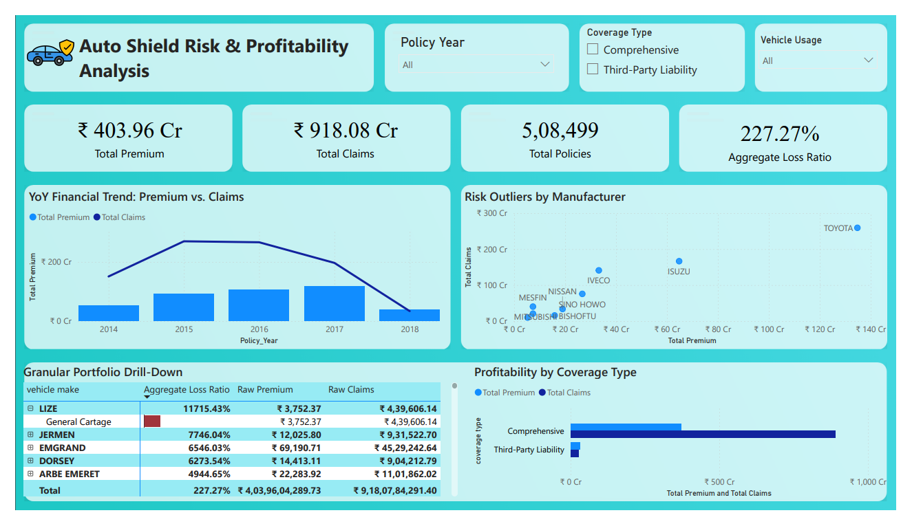

# AutoShield Insurance: Risk & Profitability Analysis

### Business Context
Motor insurance portfolios lose money when policy premiums are mispriced relative to claim frequency and vehicle usage. Using **5,08,499 motor insurance policy records** (2014–2018), this project builds a 3-step MySQL transformation pipeline and an interactive Power BI dashboard to evaluate portfolio loss ratios, compare Comprehensive vs. Third-Party Liability margins, and separate micro-sample rate outliers from high-volume commercial fleet losses.

---

### Key Findings from the Portfolio (5,08,499 Policies)
* **Overall Underwriting Deficit (`227.27%` Aggregate Loss Ratio):** Across 2014–2018, the portfolio collected **₹403.96 Cr** (`₹4,03,96,04,289.73`) in earned premiums against **₹918.08 Cr** (`₹9,18,07,84,291.40`) in paid claims—an average premium of **₹7,944.17 per policy** versus a claim burning cost of **₹18,054.68 per policy**.
* **Comprehensive vs. Third-Party Divergence:**
  * **Comprehensive (`2,77,107` policies):** Generates 92% of revenue (**₹371.63 Cr** premium) but 97% of payouts (**₹890.88 Cr** claims), running a **239.72% loss ratio** (a **₹519.25 Cr** net deficit, or **₹13,411.14** collected vs. **₹32,149.48** paid out per policy).
  * **Third-Party Liability (`2,31,392` policies):** Operates profitably at an **84.12% loss ratio** (**₹32.33 Cr** premium vs. **₹27.19 Cr** claims, generating a **+₹5.14 Cr** surplus), anchored by commercial manufacturers like **Isuzu** (`56.91%` loss ratio on `₹10.21 Cr` premium) and **Bajaji** (`24.10%` loss ratio on `₹2.04 Cr` premium).
* **Micro-Exposure Outliers vs. Multi-Crore Fleet Bleeders:**
  * Low-volume General Cartage segments create extreme percentage spikes—such as **LIZE** (`11,715.43%` loss ratio; `₹3,752.37` premium vs. `₹4,39,606.14` claims) and **JERMEN** (`7,746.04%` loss ratio).
  * In high-exposure commercial fleets, multi-crore claim losses are driven by heavy vehicle manufacturers including **Toyota**, **Isuzu**, **Iveco**, **Nissan**, **Mesfin**, **Sino Howo**, and **Bishoftu**.
* **Private vs. Commercial Usage:** Private vehicles (`1,22,220` policies) recorded a **150.86% loss ratio** (`₹69.81 Cr` premium vs. `₹105.32 Cr` claims) across the 5-year period, stabilizing to a profitable **59.37% loss ratio** in 2018 (`12,677` policies; `₹5.82 Cr` premium vs. `₹3.45 Cr` claims).

---

### Executive Dashboard

---

### Technical Architecture & Implementation

**1. Modular MySQL ETL Pipeline (`SQL/`)**
* `SQL/01_Create_Schema.sql`: Loads raw policy CSV records into the Bronze staging table (`raw_insurance_data`) using `VARCHAR(255)` schema-on-read typing to prevent ingestion failures on malformed strings.
* `SQL/02_Data_Cleaning.sql`: Materializes `silver_insurance_data` and enforces business rules:
  * Derives `COVERAGE_TYPE` (`Third-Party Liability` where `INSURED_VALUE = '0'`, otherwise `Comprehensive`).
  * Strips non-numeric characters from `EFFECTIVE_YR` using `REGEXP_REPLACE()`.
  * Coerces blank/NULL `CLAIM_PAID` entries to `'0'` and standardizes placeholder symbols (`*`), numeric years (`1984`), and country strings in `MAKE` to `'UNKNOWN'`.
* `SQL/03_Gold_Layer_Views.sql`: Exposes two analytical views for BI consumption:
  * `gold_insurance_metrics`: Parses policy dates via `STR_TO_DATE()`, casts financial fields to `DECIMAL(15,2)`, and prepares clean policy-level attributes for Power BI.
  * `gold_manufacturer_risk_summary`: Aggregates manufacturer exposure tiers (`< ₹1 Lakh` micro-outliers vs. `>= ₹1 Cr` major fleets) alongside per-policy burning cost metrics.

**2. Power BI Semantic Layer & DAX Engineering (`dashboard/`)**
* **Dedicated Measure Table (`_Key Measures`):** Centralizes KPI calculations (`Total Premium`, `Total Claims`, `Total Policies`, `Aggregate Loss Ratio`, `Avg Premium Per Policy`, and `Claim Burning Cost`) separate from the base table.
* **Parallel Crore & Exact-Rupee Measures:** Uses Crore-scaled measures (`₹ #,0.00 "Cr"`) for top-level executive KPI cards alongside unscaled `Raw Premium` and `Raw Claims` measures in the drill-down matrix so low-premium brands do not round to `₹0.00 Cr`.
* **Hierarchical Drill-Down & Temporal Filtering:** Extracts `Policy_Year = YEAR(policy_start_date)` for YoY trend analysis and implements a two-level `vehicle_make → vehicle_usage` matrix hierarchy.

---

### Repository Structure
* `SQL/` — Modular MySQL scripts (`01_Create_Schema.sql`, `02_Data_Cleaning.sql`, `03_Gold_Layer_Views.sql`).
* `dashboard/` — Interactive Power BI file (`AutoShield_Risk_Analysis.pbix`) and static PDF export (`AutoShield_Executive_Dashboard.pdf`).
* `Assets/` — Dashboard preview image (`screenshot.png`).
